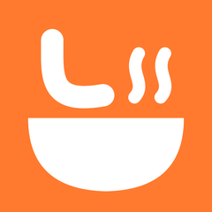
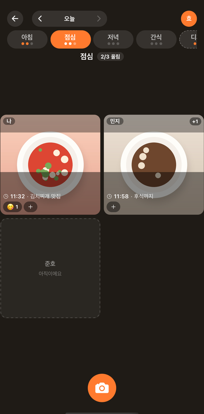
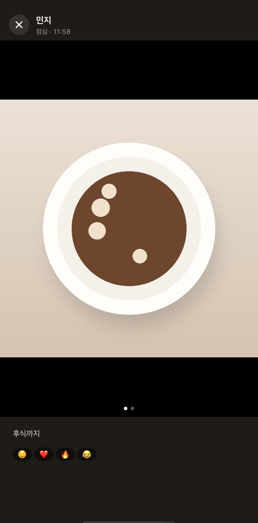
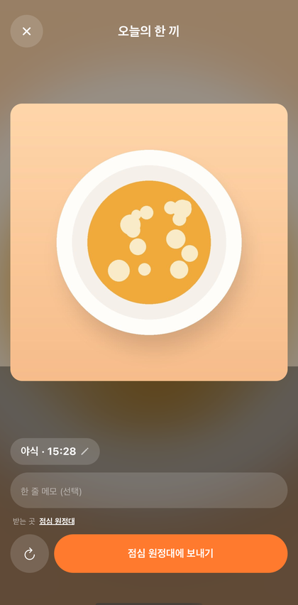
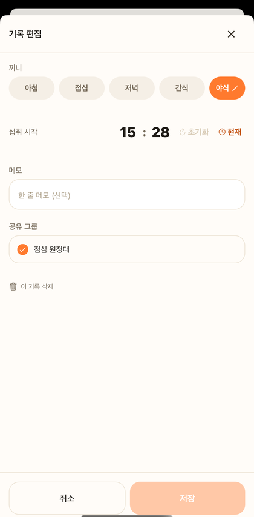

# 뇸 Nyom

**너네 오늘 뭐먹뇸?**

친구들과 먹는 순간을 가볍게 기록하고 흘려보는 식사 로그 앱

<table align="center">
  <tr>
    <td align="center"></td>
    <td align="center"></td>
    <td align="center"></td>
    <td align="center"></td>
  </tr>
  <tr>
    <td align="center"><b>끼니 보드</b> 그룹 친구들이 뭘 먹었나</td>
    <td align="center"><b>사진 상세</b> 여러 장은 넘겨 보기</td>
    <td align="center"><b>올리기</b> 야식 같은 이름은 태그로</td>
    <td align="center"><b>기록 편집</b> 끼니 · 시각 · 메모 · 그룹</td>
  </tr>
</table>

스크린샷의 사진은 그림 대체 이미지, 사람은 예시 계정이에요.

## 소개

뇸은 친한 사람들끼리 "오늘 뭐 먹었어?"를 사진 한 장으로 나누는 앱이에요.
잘 차린 한 상을 자랑하는 곳이 아니라, 편의점 라면도 부담 없이 올리고 금방 흘려보내는 곳을 만들고 싶었어요.

- 🍚 **하루 끼니 보드** — 아침 · 점심 · 저녁 · 간식마다 그룹 친구들의 한 끼가 한 화면에 모여요.
  위아래로 밀면 끼니, 좌우로 밀면 날짜가 넘어가요.
- 🏷️ **나만의 끼니 태그** — 야식 · 디저트 · 술처럼 원하는 이름을 붙이면 그날 보드에 그 페이지가 생겨요.
- 📸 **찍고 바로 보내기** — 찍은 시각으로 끼니를 골라 두고, 보낸 뒤 5초 안에는 되돌릴 수 있어요.
- 🖼️ **여러 장 넘겨 보기** — 한 끼에 여러 장 올리면 상세에서 좌우로 넘겨 봐요.
- 🤤 **1인 1리액션** — 🤤 ❤️ 🔥 😂 중 하나. 친구가 올리거나 내 사진에 반응하면 알림이 와요.
- 🗓️ **돌아보기** — 프로필 그리드와 달력으로 내가 먹은 것을 돌아보고, 올린 뒤에도 끼니 · 시각 · 메모를 고칠 수 있어요.
