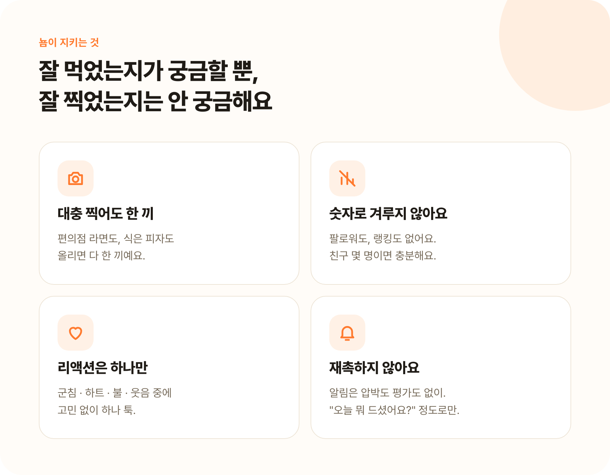
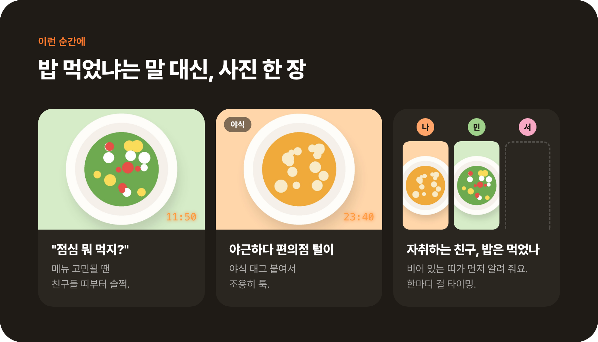
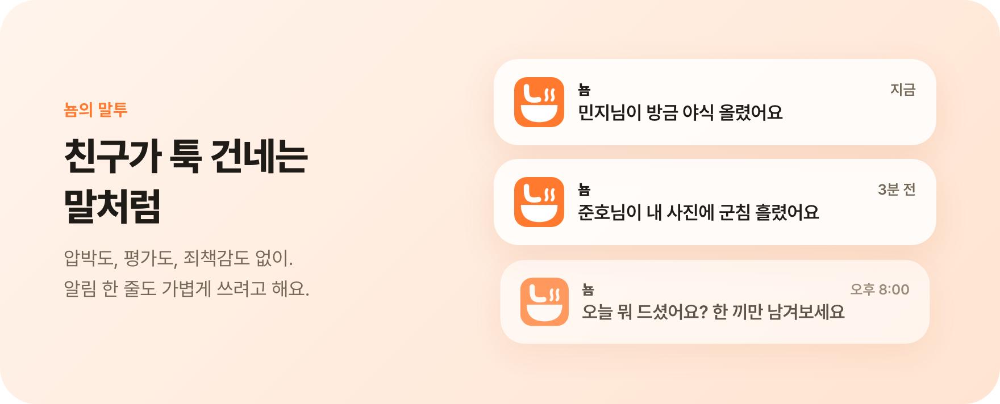
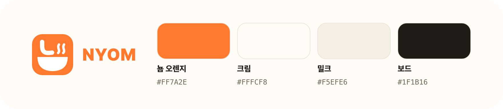

# 뇸 Nyom

**너네 오늘 뭐먹뇸?**

친구들과 먹는 순간을 가볍게 기록하고 흘려보는 식사 로그 앱

<table align="center">
  <tr>
    <td align="center"></td>
    <td align="center"></td>
    <td align="center"></td>
    <td align="center"></td>
  </tr>
  <tr>
    <td align="center"><b>방 화면</b> 멤버마다 하루의 띠</td>
    <td align="center"><b>사진 상세</b> 그 사람의 그날을 넘겨 보기</td>
    <td align="center"><b>올리기</b> 찍은 시각 그대로, 태그는 선택</td>
    <td align="center"><b>기록 편집</b> 태그 · 시각 · 메모 · 그룹</td>
  </tr>
</table>

스크린샷의 사진은 그림 대체 이미지, 사람은 예시 계정이에요.

## 소개

뇸은 친한 사람들끼리 "오늘 뭐 먹었어?"를 사진 한 장으로 나누는 앱이에요.
잘 차린 한 상을 자랑하는 곳이 아니라, 편의점 라면도 부담 없이 올리고 금방 흘려보내는 곳을 만들고 싶었어요.

- 🕰️ **멤버별 시간 띠** — 방에 들어가면 친구마다 세로 띠 하나, 사진이 먹은 시각 자리에 놓여요.
  비교보다는 각자의 하루를 넘겨 보는 사진첩이에요. 방은 4명까지예요.
- 📸 **찍은 시각 그대로** — 아침 · 점심을 고르지 않아요. 찍은 시각이 사진 위에 새겨지고, 틀렸으면 바로 고쳐요.
- 🏷️ **태그는 선택** — 야식 · 디저트 · 술처럼 붙이고 싶을 때만. 보낸 뒤 5초 안에는 되돌릴 수 있어요.
- 🖼️ **그날을 넘겨 보기** — 사진을 누르면 그 사람이 그날 올린 사진을 좌우로 넘겨 봐요.
- 🤤 **1인 1리액션** — 🤤 ❤️ 🔥 😂 중 하나. 친구가 올리거나 내 사진에 반응하면 알림이 와요.
- 🗓️ **돌아보기** — 프로필 그리드와 달력으로 내가 먹은 것을 돌아보고, 올린 뒤에도 태그 · 시각 · 메모를 고칠 수 있어요.

 

